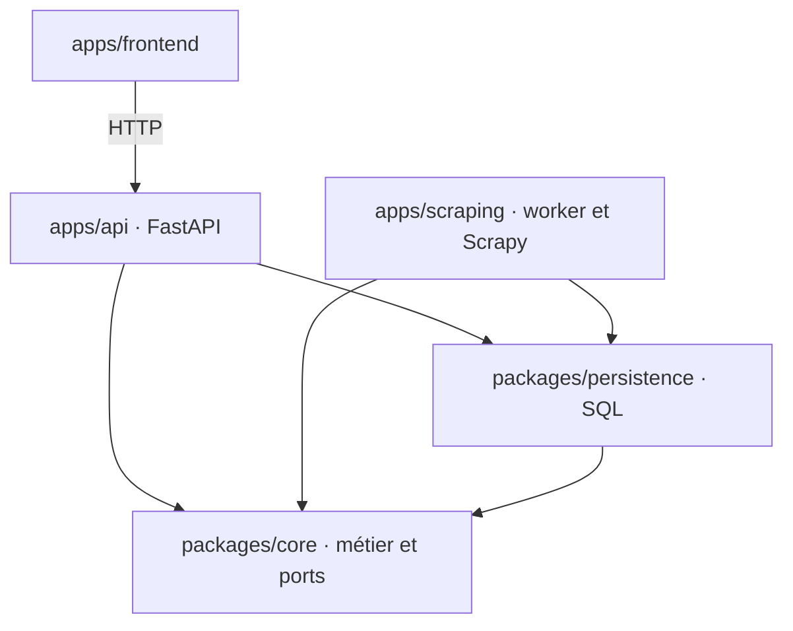
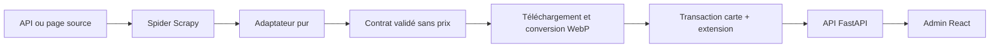
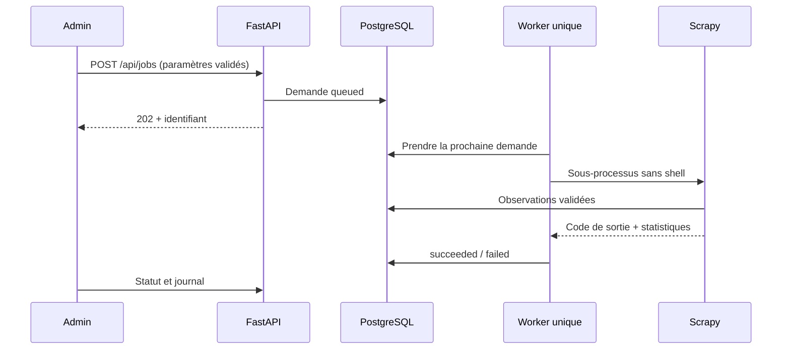

# Architecture

## Carte du dépôt

```text
apps/
  frontend/src/
    app/                     Composition, routage et présentation générale
    features/catalog/        Catalogue, fiches, médias, filtres, types et requêtes
    features/collections/    Formulaire, historique, journaux, types et requêtes
    shared/                  Transport HTTP et formatage
    components/ui/           Composants visuels génériques
  api/src/tcg_api/
    app.py                   Assemblage des adaptateurs et durée de vie du moteur
    routes/                  Traduction HTTP des cas d’usage
    schemas/                 Contrats HTTP explicites
    presentation/            Projection des médias vers les URLs locales
    security.py              Host/Origin et intention d’administration
    logs.py, static.py       Lecture des journaux et service des fichiers
  scraping/src/tcg_scraping/
    worker.py                Boucle, verrou et signaux du worker
    runner.py                Sous-processus, timeout et interprétation des résultats
    settings.py              Configuration Scrapy
    sources/tcgdex/          normalize.py pur ; spider.py pour l’acquisition HTTP
    pipelines/               Validation, médias, persistance
    middleware.py            Évitement des cartes déjà présentes
    fingerprints.py          Empreinte Scrapy par destination d’image
    extensions/              Statistiques du crawl
    cli/                     Lancement Scrapy et réindexation hors ligne
packages/
  core/src/tcg_core/
    catalog/                 Modèles, prix exclus, nommage, consultation, réindexation
    collections/             Contrats, connecteurs déclarés, ports, soumission,
                             consultation et exécution
  persistence/
    src/tcg_persistence/     Connexion, schéma, lectures/écritures SQL, maintenance
    migrations/              Versions Alembic historiques et environnement
```

Les tests propres à chaque application/bibliothèque vivent dans son dossier `tests`.
`tests/acceptance` porte les exemples métier, `tests/integration` les parcours entre
paquets et `tests/architecture` les règles de dépendance. Les tests React sont voisins
de leurs fonctionnalités. Les commandes communes restent à la racine.

## Dépendances autorisées



Core dépend de la bibliothèque standard et de Pydantic. Il n’ouvre ni connexion,
ni fichier, ni processus. Persistence implémente les ports métier ; API et scraping
assemblent les adaptateurs. Aucune application Python n’importe l’autre. Le registre
déclaratif des connecteurs ne charge aucune classe Scrapy. Les règles propres à
Pokémon restent dans sa normalisation, les invariants communs dans core.

Le workspace uv partage un verrou, mais chaque paquet déclare ses dépendances.
`tests/architecture` vérifie les imports et déclarations ; `make test-installations`
exécute les suites dans quatre environnements réellement séparés et non éditables.
Les tests ne s’appuient donc pas uniquement sur l’environnement complet du développeur.
Voir [les règles](engineering.md) et [l’ADR 0006](adr/0006-separated-applications.md).

## Responsabilités du catalogue

`tcg_core.catalog.queries` définit le port de lecture et les cas d’usage. Les données
restent indépendantes des URLs HTTP ; `tcg_api.presentation.catalog` projette les
médias sans modifier les observations reçues.

`tcg_persistence.catalog.Repository` possède le moteur SQL et les écritures
transactionnelles. Il délègue ses lectures à `catalog_reader.SqlCatalogReader`, qui
partage ce moteur sans le fermer. Les tables s’importent directement depuis
`tcg_persistence.schema`, sans passer par `catalog` ; la file vit dans
`tcg_persistence.jobs`. Les points d’entrée possèdent et ferment leurs
ressources ; les cas d’usage ne construisent pas de moteur.

Le nommage des images est une fonction pure de `tcg_core.catalog.media`, réutilisée
par les téléchargements et la maintenance. L’empreinte des requêtes appartient à
Scrapy. La commande de maintenance des images n’installe donc aucun collecteur.

## Flux d’une observation



Les relations sont jeu → bloc facultatif → extension → impression localisée,
sans fusion entre sources/langues. Les blocs sont stockés dans `localized_blocks`,
référencés par `localized_sets.block_id`. La base stocke les identités relationnelles et les documents de règles JSONB.
Les images restent sur disque. Un résumé partiel de set conserve les champs absents
ou nuls, mais remplace les valeurs renseignées ; un détail complet fait autorité.
Un résumé de bloc donne priorité aux métadonnées déjà connues. Une observation d’image en
échec n’écrase pas la version précédente.

Le middleware intercepte les requêtes portant `card_identity` et vérifie une clé
indexée avec la version du contrat. Il n’accède pas à toute la base en mémoire.
`force_refresh` autorise une relecture ; le cache d’image reste indépendant.
Il ne s’agit pas d’un verrou entre collecteurs ; la clé primaire SQL empêche les
doublons. Les listes de découverte peuvent encore être consultées.

## Flux d’une collecte



La soumission appartient à `RequestCollection`, la lecture à `CollectionQueries`,
et l’exécution à `ExecuteCollection`. Le runner traduit les statistiques Scrapy et
le code de sortie en `CollectionResult`. Les diagnostics bruts sont conservés pour
l’administration ; le métier ne connaît pas leurs clés. L’API lit les derniers
64 Ko du journal avec un adaptateur fichier, derrière un port de consultation.

`ScopedCollectionRequest(kind="collect_scope")` cible un bloc ou une extension,
sans limite de candidats. `CollectionOptions` prépare les choix derrière le port
`CollectionDiscovery`. L’adaptateur HTTP de l’API lit les listes TCGdex sans
enregistrer d’observation ; il borne ses lectures à quatre requêtes simultanées,
5 secondes par opération socket, 30 secondes d’attente de lot et 2 Mio par réponse,
et refuse les redirections. React Query conserve ces résultats cinq minutes.
Le worker résout à nouveau le périmètre ; le spider sépare son expansion de
l’enrichissement des métadonnées pour ne pas élargir une extension à son bloc.
Les variantes historiques et la réparation restent distinctes. Voir
[ADR 0009](adr/0009-scoped-collections.md).

La demande `ImageRepairRequest(kind="repair_images")` partage ce flux et utilise
le spider dédié `repair_images`. `tcg_core.catalog.image_repair.ImageRepair`
décide des fichiers manquants derrière des ports typés. Le dépôt
`tcg_persistence.image_repair.SqlImageRepairStore` parcourt les médias par lots
et ne met à jour que `image_urls` et `images`. Les adaptateurs dans scraping
vérifient les chemins, découvrent les URL TCGdex nécessaires et réutilisent la
préparation WebP ; ils n’enregistrent jamais une observation complète. Voir
[ADR 0008](adr/0008-image-repair.md).

La réparation borne également les impressions en cours à `CONCURRENT_REQUESTS`
(8 par défaut) : lire SQL par lots ne suffit pas à limiter les items en attente
dans Scrapy. Une impression libère sa place après persistance, indisponibilité
ou erreur. La conversion reste parallèle ; la publication des fichiers est
sérialisée pour protéger le stockage local utilisé depuis les threads.

Le verrou du worker repose sur le répertoire partagé des jobs. Un arrêt contrôlé
interrompt le sous-processus et marque les jobs `running` comme `interrupted`.
Après un arrêt brutal, cette récupération a lieu au redémarrage ; les `queued`
restent en attente.
Une nouvelle demande peut ignorer les cartes déjà persistées. Ce n’est pas la reprise
exacte d’un processus ni une file distribuée. Le timeout est d’une heure par collecte.

## Processus Docker et installations

Le Dockerfile fournit trois cibles runtime non root :

- `api` : distribution `tcg-api`, core/persistence et frontend compilé, sans Scrapy,
  Playwright, Pillow ou Chromium. Node reste dans le build frontend.
- `scraping` : distribution `tcg-scraping`, core/persistence, Scrapy, Pillow et
  Playwright/Chromium, sans FastAPI ni Uvicorn.
- `migrate` : core/persistence et l’historique Alembic, sans HTTP ni scraping.

Les sources du workspace restent dans les stages de construction ; les images
finales contiennent des installations non éditables. Le frontend est explicitement
configuré par `TCG_FRONTEND_DIR`. Sans ce build, l’API reste utilisable seule.

Compose attend PostgreSQL sain, puis la réussite de `migrate`, avant de démarrer
`api` et `worker`. Un init transmet les signaux ; le worker dispose de 30 secondes
pour terminer son enfant lors d’un arrêt normal. Les volumes, chemins, services et
variables existants sont préservés. Seuls les services de test sont redémarrés par
les validations automatiques.

La base reste partagée, comme le dossier hôte `data/` monté dans `/data`. Les
UID/GID sont configurables. L’API écoute `0.0.0.0` dans le conteneur ; le port hôte
reste publié sur `127.0.0.1`.

La résolution de connexion appartient à `tcg_persistence.configuration`. Une URL
explicite prime sur les paramètres PostgreSQL structurés, puis vient SQLite. Compose
utilise `postgres:5432` et ne transmet pas l’URL locale de l’hôte.

## Contrats HTTP et navigation

La [référence API](api.md) décrit les routes, paramètres, limites, erreurs et
exemples de requêtes. Les schémas générés sont disponibles sur `/docs` et
`/openapi.json`, même lorsque le frontend n’est pas configuré.

React Router gère `/`, `/collections` et
`/cards/:game/:source/:language/:sourceId`. FastAPI sert le HTML sur les liens directs
connus ; une route API ou un fichier absent reste une erreur 404. Les schémas HTTP
sont explicites et ne reflètent pas implicitement chaque colonne SQL.

## Limites et évolution

Admin local sans authentification : contrôle Host, Origin et en-tête d’intention
sur les mutations, pas de CORS permissif. Les origins autorisées correspondent aux
ports 8000 et 5173. Un accès réseau demanderait une conception d’authentification.

Un worker, stockage local, accès SQL synchrone : mesurer avant d’ajouter des écritures
groupées, index JSONB, stockage objet ou ordonnanceur distribué. Ne pas créer
plusieurs impressions pour les variantes sans définir leur identité et nommage.
L’exhaustivité reste limitée par chaque source et chaque langue.

Pour Playwright, activer `meta={"playwright": True}` uniquement sur les requêtes qui
en ont besoin. Éviter de conserver une page navigateur sans gérer sa fermeture.
Les limites de téléchargement et le throttling restent dans
`apps/scraping/src/tcg_scraping/settings.py`.
